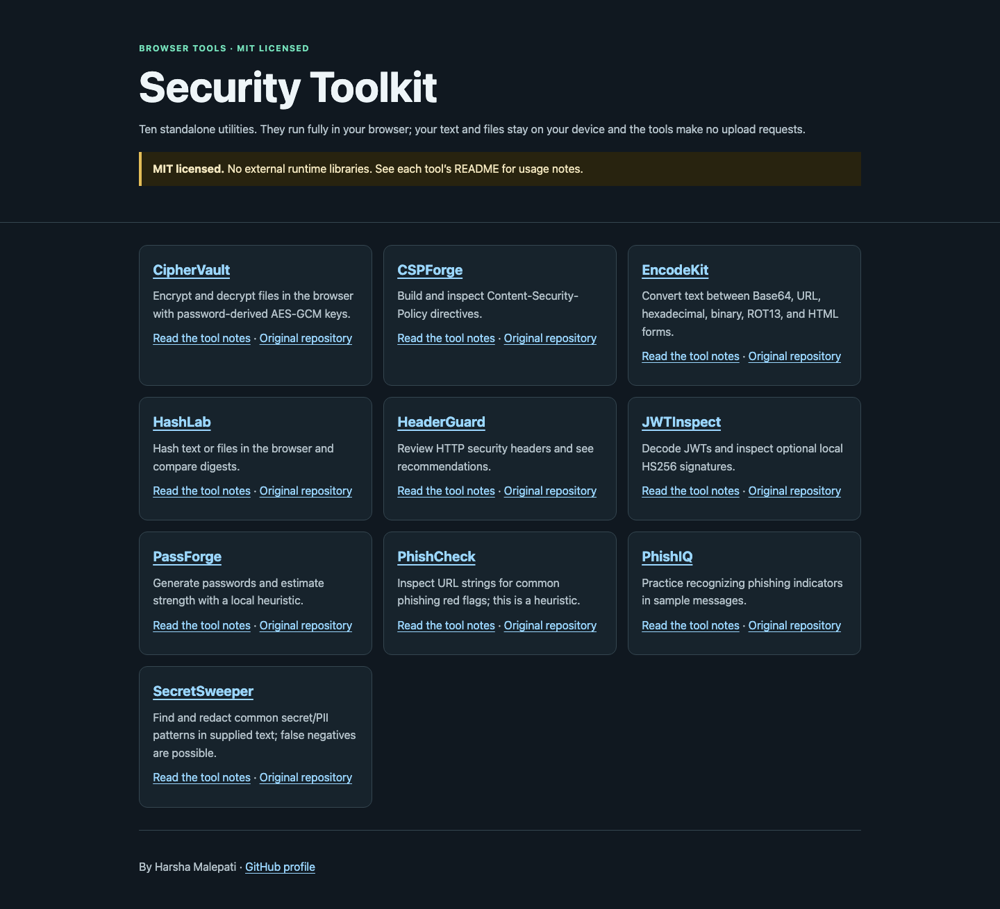

# Security Toolkit

[](https://github.com/harshacreate/security-toolkit/actions/workflows/tests.yml)

A collection of ten small, standalone browser utilities. **They run in your browser; your text and files stay on your device and the tools make no upload requests.** The pages use no external runtime libraries.



## Tools

| Tool | What it does | Live page |
|---|---|---|
| CipherVault | Encrypts and decrypts text or files with password-derived AES-GCM keys. | [Open CipherVault](https://harshacreate.github.io/security-toolkit/tools/CipherVault/) |
| CSPForge | Builds and reviews Content Security Policy directives. | [Open CSPForge](https://harshacreate.github.io/security-toolkit/tools/CSPForge/) |
| EncodeKit | Converts text between Base64, URL, hexadecimal, binary, ROT13, and HTML forms. | [Open EncodeKit](https://harshacreate.github.io/security-toolkit/tools/EncodeKit/) |
| HashLab | Hashes text or files in the browser and compares digests. | [Open HashLab](https://harshacreate.github.io/security-toolkit/tools/HashLab/) |
| HeaderGuard | Reviews HTTP security headers and presents recommendations. | [Open HeaderGuard](https://harshacreate.github.io/security-toolkit/tools/HeaderGuard/) |
| JWTInspect | Decodes JWTs and inspects claims and optional local HS256 signatures. | [Open JWTInspect](https://harshacreate.github.io/security-toolkit/tools/JWTInspect/) |
| PassForge | Generates passwords and estimates strength using a local heuristic. | [Open PassForge](https://harshacreate.github.io/security-toolkit/tools/PassForge/) |
| PhishCheck | Checks URL strings for common phishing indicators. | [Open PhishCheck](https://harshacreate.github.io/security-toolkit/tools/PhishCheck/) |
| PhishIQ | Practices recognizing phishing indicators in sample messages. | [Open PhishIQ](https://harshacreate.github.io/security-toolkit/tools/PhishIQ/) |
| SecretSweeper | Finds common secret and PII patterns in text for review and redaction. | [Open SecretSweeper](https://harshacreate.github.io/security-toolkit/tools/SecretSweeper/) |

## Run locally

Open `index.html` in a browser, or serve the repository root with `python3 -m http.server 8000` and visit `http://localhost:8000`.

## Tests

Each page has a Playwright browser smoke test that exercises one core interaction. The tests also check that the tool interactions make no external requests and that the landing page fits a mobile viewport.

```sh
npm ci
npx playwright install chromium
npm test
```

## GitHub Pages

The workflow in `.github/workflows/pages.yml` publishes the repository root. Set the repository's Pages source to **GitHub Actions** to enable the live links above.

## Scope and license

These are educational utilities. Review the README in each tool folder for its behavior and limits. The root and original tool folders are MIT-licensed; see `LICENSE` files.
